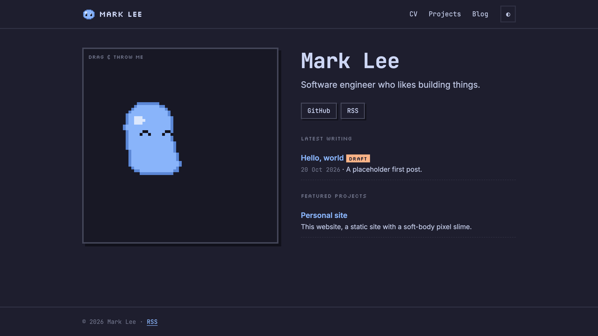

# markymarklee.github.io

My personal site: CV, projects, and a blog. A pixel slime stands in for a photo of me.



**Live:** https://markymarklee.github.io

## What's here

- **Pixel slime.** A soft body made of springs, drawn as chunky pixels every frame. You can drag it and throw it around its box.
- **CV, projects, and blog.** Each one is a Markdown file in [`content/`](content/), built into static pages.
- **Catppuccin.** Mocha for dark mode, Latte for light.
- **Fully static.** Built with [Vite+](https://viteplus.dev) and deployed to GitHub Pages on every push to `main`.

## Develop

```bash
vp install
vp dev      # preview with live reload (drafts visible)
vp check    # format, lint, type check
vp test
vp build    # outputs to dist/
```

To write a post, add `content/blog/<slug>/index.md` (see [AGENTS.md](AGENTS.md) for the frontmatter), or run `/write-content` in Claude Code and write it together.
